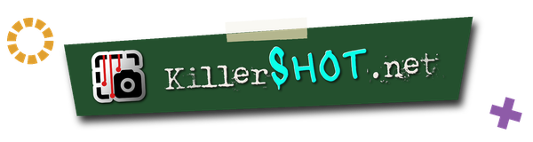
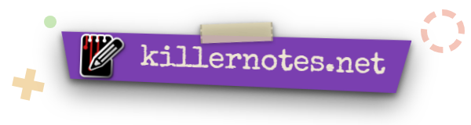
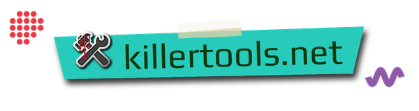
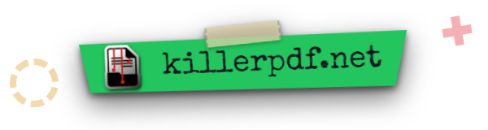
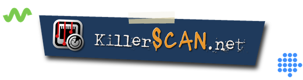
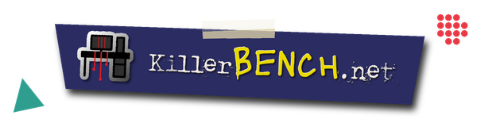

 

I grew up taking things apart to see how they worked, and somewhere along the way I learned to enjoy putting them back together too. I've been building for the web since the 90s, when a personal site meant hand-written HTML and a lot of trial and error. Around 2008 I was designing GTK 2.0 themes for fun and posting them on Ubuntu Forums under the name **Saint Angeles**. That turned into roughly eight years of full-stack development, building sites and applications end to end, before the work pulled me toward the systems underneath them.

After about 8 years as a field tech across several companies, handling networking, sysadmin work, and endpoint support, I now work as an AI Solutions Specialist on a large MSP's internal AI engineering team, building the tooling I used to wish I had in the field. I also run a Proxmox-based homelab with Home Assistant, Pi-Hole, OpenWrt, Umami, and whatever else I'm taking apart at the moment.

Most software today is bloated, tracks you, and drags in dependencies nobody asked for. I don't think you should need an account to use a tool. The projects I build are my answer to that: single executables, no telemetry, no subscriptions, no bullshit. If that sounds like your kind of software, check out [KillerTools.net](https://killertools.net).

## Projects

| Project | Description | Tech |
| :--- | :--- | :--- |
| [**KillerPDF**](https://github.com/SteveTheKiller/KillerPDF) | A full-featured PDF editor for Windows that installs normally or runs fully portable. Licensed under GPLv3 with no account required, no subscription, and no telemetry of any kind. | `C#` |
| [**KillerScan**](https://github.com/SteveTheKiller/KillerScan) | A fast network scanner built for field techs that combines ARP and ping discovery, port probing, and active fingerprinting across HTTP, SSH, TLS, NetBIOS, and SNMP. Uses a weighted scoring system to classify devices and ships as a single portable executable with no dependencies. | `C#` |
| [**KillerShell**](https://github.com/SteveTheKiller/KillerShell) | A file browser, terminal, and text editor sharing one window, one tab strip, and one set of keys. Wildcard filename and line-by-line content search with no indexing and no background services, PowerShell and cmd tabs that open in the folder you were browsing, and a plain text editor with syntax highlighting for ps1, reg, ini, logs, and the usual data formats. | `C#` |
| [**KillerNotes**](https://github.com/SteveTheKiller/KillerNotes) | An encrypted notepad for techs: instant full-text search, rich text with inline images and real tables, whole-database SQLCipher AES-256 encryption, and notes that tear off as shareable .knote files. Ships as a single signed portable executable. | `C#` |
| [**Killendar**](https://github.com/SteveTheKiller/Killendar) | An encrypted desktop calendar for Windows with month, week, day, and agenda views, colour categories you define yourself, and iCalendar import and export. Appointments live in one SQLite file in your own profile, optionally encrypted at rest with SQLCipher AES-256. No account, no sync service, and nothing phoning home. | `C#` |
| [**killer&#8209;scripts**](https://github.com/SteveTheKiller/killer-scripts) | A growing collection of PowerShell scripts designed to make Windows computers actually behave the way you configure them, built for MSP field work and day-to-day endpoint management. | `PowerShell` |
| [**killer&#8209;tools&#8209;site**](https://github.com/SteveTheKiller/killer-tools-site) | The source code for killertools.net, home of the Killer Tools suite. | `TypeScript` |

### Languages & Runtimes

### Platforms & Tools

---

  

